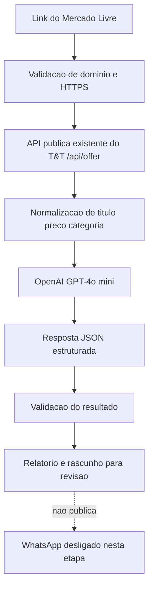

# T&T AI — Curadoria inteligente de ofertas

**Projeto:** [T&T Barateou](https://github.com/gut0o/T-T-barateou)
**Finalidade:** portfólio de Inteligência Artificial — Futures / Softplan 2027
**Status:** protótipo funcional de IA, testado com produto real. **Não integrado ao envio automático de WhatsApp.**

## 1. Qual problema o projeto resolve?

Quem administra grupos de ofertas precisa descobrir produtos, conferir informações, selecionar itens pertinentes ao público e escrever mensagens claras. O T&T já automatiza partes operacionais da descoberta e publicação, mas uma regra tradicional de categoria/ranking não explica *para quem* um produto pode ser relevante ou *por que* deveria chamar atenção.

**Hipótese do protótipo:** um modelo de linguagem pode apoiar a curadoria qualitativa e a criação de mensagens para diferentes públicos, mantendo checagens objetivas de preço e link fora do modelo.

## 2. Onde a IA entra — e onde ela não entra

| Etapa | Tecnologia | Responsabilidade |
|---|---|---|
| Resolver link do anúncio | Endpoint existente `GET /api/offer` do T&T | Buscar título, categoria e preço informados na origem |
| Validar entrada | Node.js / regras determinísticas | Rejeitar domínio, moeda e preço inválidos |
| **Avaliar relevância** | **OpenAI `gpt-4o-mini`** | Sugerir público, potencial qualitativo e justificativa |
| Criar mensagem | Modelo + template controlado | Sugerir chamada sem inventar preços ou promessas |
| Revisar e publicar | Revisão humana (no protótipo) | Decidir se o rascunho pode ser divulgado |

A IA **não pesquisa histórico de preços**, **não comprova desconto real**, **não cria links de afiliado**, **não decide sozinha publicar** e **não altera a fila**.

## 3. Arquitetura



### Decisões de engenharia

- **Separação de responsabilidades:** dados do produto vêm da API existente; texto qualitativo vem do modelo.
- **Saída estruturada:** o modelo deve retornar JSON com `potencial`, `publicoAlvo`, `justificativa`, `chamada`, `cuidados`.
- **Falha segura:** respostas inválidas, recusadas ou truncadas são rejeitadas em vez de usadas.
- **Superfície limitada:** apenas links HTTPS em domínios permitidos; nenhuma chave administrativa ou leitura de fila necessária.
- **Proteção de credenciais:** a chave `OPENAI_API_KEY` fica apenas na sessão/ambiente; evidências exportadas não registram credenciais ou links afiliados.
- **Custo observável:** contabilização dos tokens retornados pela API.

## 4. Evidências verificadas

**Em 10/11/2026**, o protótipo foi executado contra um anúncio real, com retorno efetivo do `gpt-4o-mini`:

| Campo | Resultado observado |
|---|---|
| Anúncio | Hugo Boss Jeans EDT Perfume Masculino 125 ml |
| ID | `MLB5066134658` |
| Preço consultado | R$ 316,94 |
| Preço anterior informado na fonte | R$ 689,00 |
| Potencial estimado pela IA | Médio |
| Público sugerido | Homens que buscam fragrâncias de marca sofisticada |
| Tokens desta execução | 450 |
| Publicações automáticas efetuadas | 0 |

A execução do usuário passou em **11 de 11 testes locais** antes da consulta real. Esta pasta também inclui um pequeno gerador de evidência e **4 novos testes** de integridade do relatório, totalizando **15 testes locais** na versão do portfólio. Os quatro testes adicionais foram executados localmente na preparação do pacote, não no computador do candidato. Veja [resultado real detalhado](RESULTADO-REAL-2026-11-10.md).

**Não foram medidos:** taxa de clique, vendas, aumento de conversão, tempo economizado ou qualidade comparativa contra curadoria humana. Esses indicadores são próximos experimentos, não resultados já alcançados.

## 5. Como reproduzir

Pré-requisitos: Node.js 18+, conexão à internet, chave de API OpenAI com acesso ao modelo; o endpoint público do T&T deve estar disponível.

No PowerShell, na raiz do repositório:

```powershell
# Nunca grave a chave no repositório.
$env:OPENAI_API_KEY="SUA_CHAVE_AQUI"

# Testes automatizados (não consomem API paga)
node --test tests/tt-ai-curator.test.mjs tests/tt-ai-link-offers.test.mjs tests/tt-ai-portfolio-report.test.mjs

# Uma análise real, apenas leitura, sem WhatsApp
node scripts/ai-curator-links.mjs "https://meli.la/SEU_LINK"

# De 1 a 3 análises reais COM relatórios Markdown e JSON
node scripts/ai-curator-portfolio.mjs "https://meli.la/SEU_LINK"
```

O último comando grava evidências em `docs/softplan/evidencias/`. Revise o conteúdo antes de versionar. Não inclua chaves, arquivos `.env` ou dados pessoais nos commits.

## 6. Estrutura do protótipo

| Arquivo | Papel |
|---|---|
| `lib/tt-ai-curator.js` | Integração OpenAI, validação de resposta e rascunho |
| `lib/tt-ai-link-offers.js` | Consulta ao endpoint público `/api/offer` |
| `lib/tt-ai-portfolio-report.js` | Exporta somente campos aprovados das evidências |
| `scripts/ai-curator-links.mjs` | Demonstração em terminal |
| `scripts/ai-curator-portfolio.mjs` | Demonstração e documentação automática |
| `tests/tt-ai-*.test.mjs` | Testes com mocks, sem custo de API |

## 7. Próximas evoluções

1. Rodar análises com outros dois anúncios reais e revisar se as justificativas fazem sentido.
2. Comparar avaliação IA x critérios humanos em um conjunto maior de ofertas.
3. Acrescentar dados confiáveis de histórico de preços e avaliações, se disponíveis e autorizados.
4. Introduzir aprovação humana no painel antes de qualquer possível integração ao fluxo de publicação.
5. Medir tempo economizado e qualidade das mensagens antes de avaliar impacto comercial.

## 8. Segurança e limites

O protótipo consulta informações públicas do anúncio através do T&T. Dados de produtos são tratados como entradas não confiáveis e não como instruções para o modelo. Não há envio de mensagens, escrita no Supabase ou chamada à API administrativa de fila neste módulo.

Os valores refletem o momento da consulta; podem mudar. O objetivo da IA é **auxiliar uma pessoa a decidir**, não afirmar que um desconto é verdadeiro ou recomendar automaticamente uma compra.

---

**Documentos adicionais:** [roteiro do vídeo](ROTEIRO-VIDEO.md) · [texto para inscrição](TEXTO-INSCRICAO.md) · [demonstração visual offline](apresentacao.html)
